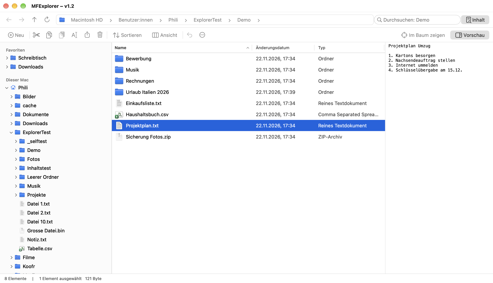
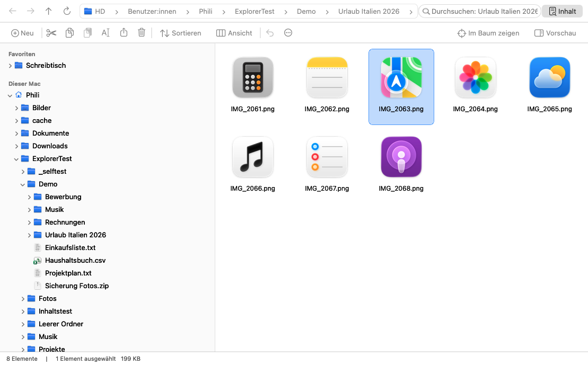

# MFExplorer

**Ein Dateimanager für den Mac, der sich wie der Windows Explorer bedient.**
Für alle, die von Windows auf den Mac umsteigen und den Finder ungewohnt finden.

MFExplorer übernimmt den Aufbau und die Gewohnheiten des Windows Explorers: Ordnerbaum links, Detailansicht mit Spalten, Adressleiste mit klickbarem Pfad, Befehlsleiste, Statusleiste und die Tastenkürzel. Aussehen und Symbole sind dabei ganz macOS.

> Die App ist zurzeit nur auf **Deutsch** verfügbar.





## Funktionen

- **Ordnerbaum, der stillhält:** Seitenleiste und Hauptansicht navigieren unabhängig voneinander. So zieht man Dateien mühelos von einem Ort an einen anderen.
- **Detailansicht** mit Spalten (Name, Änderungsdatum, Typ, Größe, Erstellungsdatum …), die man verbreitern, verschieben und ein- und ausblenden kann. Dazu kommen **Symbolansichten** mit Vorschaubildern.
- **Drag & Drop** zwischen Liste, Baum, Finder, Schreibtisch und Mail. Gleiches Laufwerk heißt verschieben, anderes Laufwerk heißt kopieren. Mit ⌥ wird immer kopiert, mit ⌘ immer verschoben.
- **Sicher:** Löschen legt immer in den Papierkorb. Nichts wird ungefragt überschrieben, die App fragt dann „Beide behalten / Ersetzen / Überspringen“. **Jede Aktion lässt sich mit ⌘Z rückgängig machen.**
- **Ausschneiden, Kopieren, Einfügen**, Umbenennen mit F2, neuer Ordner, Rechtsklick-Menüs, Auswahlrechteck
- **Vorschaubereich** und **Schnellansicht mit der Leertaste**, für Ordner mit Anzahl, Größe und Datum
- **Tabs**, **Suche** nach Namen oder im Dateiinhalt (über den macOS-Suchindex) in allen Unterordnern, ZIP packen und entpacken, Tags, Eigenschaften-Fenster
- Beim Kopieren werden **gleichnamige Ordner zusammengeführt**, wie bei Windows.
- **Windows-Tastenkürzel:** F2, Entf, Enter, ⌥↑ (eine Ebene hoch), F5. In den Einstellungen gibt es dazu optional Strg+C/V/X/Z usw.

## Installation

1. Unter [**Releases**](../../releases) die neueste Datei `MFExplorer-<Version>.zip` herunterladen und doppelklicken.
2. `MFExplorer.app` in den Ordner **Programme** ziehen.
3. **Beim ersten Öffnen:** Die App ist nicht von Apple beglaubigt. macOS zeigt deshalb eine Warnung. So öffnest du sie trotzdem:
   - Doppelklicke die App und schließe die Meldung.
   - Öffne **Systemeinstellungen → Datenschutz & Sicherheit**.
   - Klicke unten bei „MFExplorer wurde blockiert“ auf **„Trotzdem öffnen“** und bestätige.

   Das ist nur einmal nötig.

**Voraussetzung:** macOS 15 (Sequoia) oder neuer.

**Zugriff auf Ordner:** Beim ersten Öffnen von Schreibtisch, Dokumenten oder Downloads fragt macOS nach einer Erlaubnis. Für alle Ordner auf einmal kannst du MFExplorer unter *Systemeinstellungen → Datenschutz & Sicherheit → Festplattenvollzugriff* freigeben.

## Datenschutz

MFExplorer sammelt keine Daten, hat keine Werbung und baut keine Verbindung ins Internet auf.

## Selbst bauen

Dafür brauchst du Xcode 27 oder neuer.

```bash
xcodebuild -project MFExplorer.xcodeproj -target MFExplorer -configuration Release SYMROOT="$PWD/build" build
open build/Release/MFExplorer.app
```

Das App-Symbol wird aus `Tools/make_icon.swift` erzeugt.

## Lizenz

[MIT](LICENSE) © 2026 PhilippKom

„Windows“ ist eine Marke der Microsoft Corporation, „Mac“ und „macOS“ sind Marken von Apple Inc. Dieses Projekt steht mit keinem der beiden Unternehmen in Verbindung.
